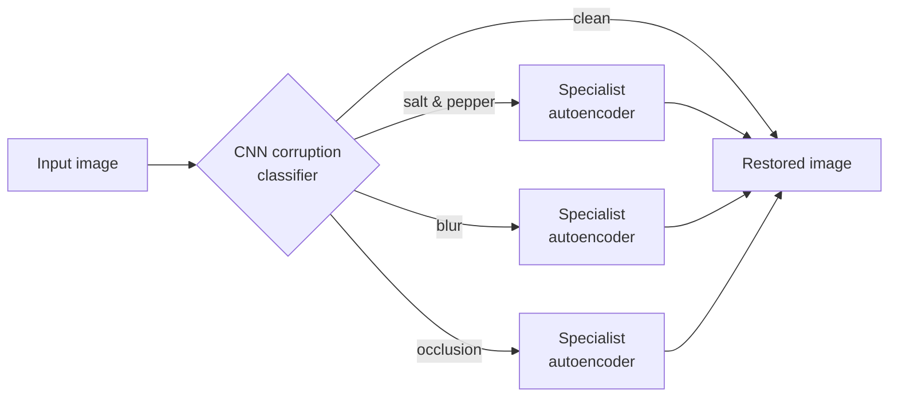
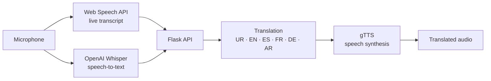

<!--
  ┌──────────────────────────────────────────────────────────┐
  │  GitHub Profile README — Abdullah Rasheed                 │
  │                                                            │
  │  Design: GitHub-native palette, light + dark variants     │
  │  Accents: blue #58A6FF · purple #A371F7 · green #3FB950    │
  │                                                            │
  │  Header, project cards, timeline and footer are animated  │
  │  SVGs in /assets, generated by scripts/build_assets.py.   │
  │  Edit the PROJECTS / TIMELINE data there, then run:       │
  │      python scripts/build_assets.py                        │
  │                                                            │
  │  Each image is wrapped in <picture> so GitHub serves the  │
  │  -dark or -light variant to match the viewer's theme.     │
  │                                                            │
  │  Search for "═══" to jump between sections.               │
  │                                                            │
  │  Last updated: October 2026                               │
  └──────────────────────────────────────────────────────────┘
-->


<!-- ═══════════════════════ HERO ═══════════════════════ -->

<picture>
  <source media="(prefers-color-scheme: dark)" srcset="https://raw.githubusercontent.com/AbdullahRasheed452/AbdullahRasheed452/main/assets/header-dark.svg" />
  <source media="(prefers-color-scheme: light)" srcset="https://raw.githubusercontent.com/AbdullahRasheed452/AbdullahRasheed452/main/assets/header-light.svg" />
  
</picture>

<p align="center">
  <a href="https://linkedin.com/in/abdullah-rasheed452"></a>
  <a href="mailto:abdullah.rasheed452@gmail.com"></a>
  <a href="https://github.com/AbdullahRasheed452?tab=repositories"></a>
  
</p>


<!-- ═══════════════════════ ABOUT ═══════════════════════ -->

## About

I'm a Computer Science student at **FAST NUCES, Islamabad**, specializing in artificial intelligence and machine learning engineering. My work spans classical classification pipelines and feature engineering, generative models, multi-agent decision environments and real-time AI applications. I care most about turning core algorithms into structured, reproducible software.

Previously I interned as a Machine Learning Engineer at [FlyRank AI](https://www.flyrank.com), working on data preprocessing, model evaluation and Python pipeline development.

```python
class Abdullah:
    studies    = "Computer Science @ FAST NUCES, Islamabad"
    previously = "ML Engineering Intern @ FlyRank AI"
    focus      = ["machine learning", "deep learning", "generative AI", "agentic AI"]
    toolbox    = ["Python", "PyTorch", "scikit-learn", "FastAPI", "Docker"]
    exploring  = ["large language models", "RAG systems", "MLOps"]

    def approach(self) -> str:
        return "turn core algorithms into structured, reproducible software"
```


<!-- ═══════════════════ FEATURED PROJECTS ═══════════════════

  Cards: assets/projects/<slug>-{dark,light}.svg
  Cards with a repo are wrapped in a link; the others are not.

-->

## Featured Projects

<p align="center">
  <a href="https://github.com/AbdullahRasheed452/GENAI-1"><picture>
    <source media="(prefers-color-scheme: dark)" srcset="https://raw.githubusercontent.com/AbdullahRasheed452/AbdullahRasheed452/main/assets/projects/restoration-studio-dark.svg" />
    <source media="(prefers-color-scheme: light)" srcset="https://raw.githubusercontent.com/AbdullahRasheed452/AbdullahRasheed452/main/assets/projects/restoration-studio-light.svg" />
    
  </picture></a>
  <a href="https://github.com/AbdullahRasheed452/voice_translator"><picture>
    <source media="(prefers-color-scheme: dark)" srcset="https://raw.githubusercontent.com/AbdullahRasheed452/AbdullahRasheed452/main/assets/projects/voiceflow-dark.svg" />
    <source media="(prefers-color-scheme: light)" srcset="https://raw.githubusercontent.com/AbdullahRasheed452/AbdullahRasheed452/main/assets/projects/voiceflow-light.svg" />
    
  </picture></a>
  <a href="https://github.com/AbdullahRasheed452/Intelligent-Reading-Comprehension-Quiz-Generator"><picture>
    <source media="(prefers-color-scheme: dark)" srcset="https://raw.githubusercontent.com/AbdullahRasheed452/AbdullahRasheed452/main/assets/projects/quiz-generator-dark.svg" />
    <source media="(prefers-color-scheme: light)" srcset="https://raw.githubusercontent.com/AbdullahRasheed452/AbdullahRasheed452/main/assets/projects/quiz-generator-light.svg" />
    
  </picture></a>
  <picture>
    <source media="(prefers-color-scheme: dark)" srcset="https://raw.githubusercontent.com/AbdullahRasheed452/AbdullahRasheed452/main/assets/projects/stochastic-battlefield-dark.svg" />
    <source media="(prefers-color-scheme: light)" srcset="https://raw.githubusercontent.com/AbdullahRasheed452/AbdullahRasheed452/main/assets/projects/stochastic-battlefield-light.svg" />
    
  </picture>
  <picture>
    <source media="(prefers-color-scheme: dark)" srcset="https://raw.githubusercontent.com/AbdullahRasheed452/AbdullahRasheed452/main/assets/projects/warehouse-optimization-dark.svg" />
    <source media="(prefers-color-scheme: light)" srcset="https://raw.githubusercontent.com/AbdullahRasheed452/AbdullahRasheed452/main/assets/projects/warehouse-optimization-light.svg" />
    
  </picture>
</p>

<details>
<summary><b>Under the hood</b>: architecture diagrams</summary>

<br>

**Restoration & Sketch Studio**: the hard-routed restoration pipeline. A soft mixture-of-experts variant blends the same branches with learned gate weights; a style-conditioned U-Net + PatchGAN generates face sketches. Models are exported to ONNX and served by FastAPI behind a Docker Compose stack.



**VoiceFlow AI**: real-time speech-to-speech translation.



</details>


<!-- ═══════════════════ TIMELINE ═══════════════════ -->

## Journey

<picture>
  <source media="(prefers-color-scheme: dark)" srcset="https://raw.githubusercontent.com/AbdullahRasheed452/AbdullahRasheed452/main/assets/timeline-dark.svg" />
  <source media="(prefers-color-scheme: light)" srcset="https://raw.githubusercontent.com/AbdullahRasheed452/AbdullahRasheed452/main/assets/timeline-light.svg" />
  
</picture>


<!-- ═══════════════════ TECH STACK ═══════════════════

  Icons via skillicons.dev; keep the dark and light lists in sync.
  Commas are written as %2C because srcset treats a bare comma as a separator.
  Valid icon slugs: https://skillicons.dev

-->

## Tech Stack

<p align="center">
  <a href="https://skillicons.dev"><picture>
    <source media="(prefers-color-scheme: dark)" srcset="https://skillicons.dev/icons?i=python%2Ccpp%2Cjava%2Cjs%2Chtml%2Ccss%2Cpytorch%2Csklearn%2Cflask%2Cfastapi%2Cdocker%2Cmysql%2Cgit%2Cgithub%2Cvscode%2Candroidstudio&theme=dark&perline=8" />
    <source media="(prefers-color-scheme: light)" srcset="https://skillicons.dev/icons?i=python%2Ccpp%2Cjava%2Cjs%2Chtml%2Ccss%2Cpytorch%2Csklearn%2Cflask%2Cfastapi%2Cdocker%2Cmysql%2Cgit%2Cgithub%2Cvscode%2Candroidstudio&theme=light&perline=8" />
    
  </picture></a>
</p>

| Area | Stack |
|:--|:--|
| **Languages** | Python · C++ · Java · JavaScript · SQL · HTML · CSS |
| **ML & Data** | PyTorch · scikit-learn · NumPy · Pandas · Seaborn · ONNX · Optuna · MLflow |
| **Apps & Serving** | Flask · FastAPI · Streamlit · Docker |
| **Tools** | Git · GitHub · Jupyter · VS Code · Android Studio · MySQL |


<!-- ═══════════════════ GITHUB ANALYTICS ═══════════════════

  Third-party cards, recoloured to the same palette as the SVG assets.
  Dark: bg 161b22 · Light: bg f6f8fa

-->

## GitHub Activity

<p align="center">
  <picture>
    <source media="(prefers-color-scheme: dark)" srcset="https://github-stats-extended.vercel.app/api?username=AbdullahRasheed452&show_icons=true&include_all_commits=true&hide_border=true&border_radius=14&bg_color=161b22&title_color=58a6ff&icon_color=a371f7&text_color=c9d1d9&ring_color=58a6ff&cache_seconds=1800" />
    <source media="(prefers-color-scheme: light)" srcset="https://github-stats-extended.vercel.app/api?username=AbdullahRasheed452&show_icons=true&include_all_commits=true&hide_border=true&border_radius=14&bg_color=f6f8fa&title_color=0969da&icon_color=8250df&text_color=1f2328&ring_color=0969da&cache_seconds=1800" />
    
  </picture>
  <picture>
    <source media="(prefers-color-scheme: dark)" srcset="https://github-stats-extended.vercel.app/api/top-langs/?username=AbdullahRasheed452&layout=compact&langs_count=6&hide_border=true&border_radius=14&bg_color=161b22&title_color=58a6ff&text_color=c9d1d9&cache_seconds=1800" />
    <source media="(prefers-color-scheme: light)" srcset="https://github-stats-extended.vercel.app/api/top-langs/?username=AbdullahRasheed452&layout=compact&langs_count=6&hide_border=true&border_radius=14&bg_color=f6f8fa&title_color=0969da&text_color=1f2328&cache_seconds=1800" />
    
  </picture>
</p>

<p align="center">
  <picture>
    <source media="(prefers-color-scheme: dark)" srcset="https://streak-stats.demolab.com?user=AbdullahRasheed452&hide_border=true&border_radius=14&background=161B22&stroke=30363D&ring=58A6FF&fire=A371F7&currStreakNum=E6EDF3&sideNums=E6EDF3&currStreakLabel=58A6FF&sideLabels=8B949E&dates=8B949E" />
    <source media="(prefers-color-scheme: light)" srcset="https://streak-stats.demolab.com?user=AbdullahRasheed452&hide_border=true&border_radius=14&background=F6F8FA&stroke=D0D7DE&ring=0969DA&fire=8250DF&currStreakNum=1F2328&sideNums=1F2328&currStreakLabel=0969DA&sideLabels=59636E&dates=59636E" />
    
  </picture>
</p>


<!-- ═══════════════════ CONTRIBUTION SNAKE ═══════════════════

  Generated daily by GitHub Actions (.github/workflows/snake.yml)
  and published to the 'output' branch.

-->

<p align="center">
  <picture>
    <source media="(prefers-color-scheme: dark)" srcset="https://raw.githubusercontent.com/AbdullahRasheed452/AbdullahRasheed452/output/github-snake-dark.svg" />
    <source media="(prefers-color-scheme: light)" srcset="https://raw.githubusercontent.com/AbdullahRasheed452/AbdullahRasheed452/output/github-snake.svg" />
    
  </picture>
</p>


<!-- ═══════════════════ FOOTER ═══════════════════ -->

<picture>
  <source media="(prefers-color-scheme: dark)" srcset="https://raw.githubusercontent.com/AbdullahRasheed452/AbdullahRasheed452/main/assets/footer-dark.svg" />
  <source media="(prefers-color-scheme: light)" srcset="https://raw.githubusercontent.com/AbdullahRasheed452/AbdullahRasheed452/main/assets/footer-light.svg" />
  
</picture>
